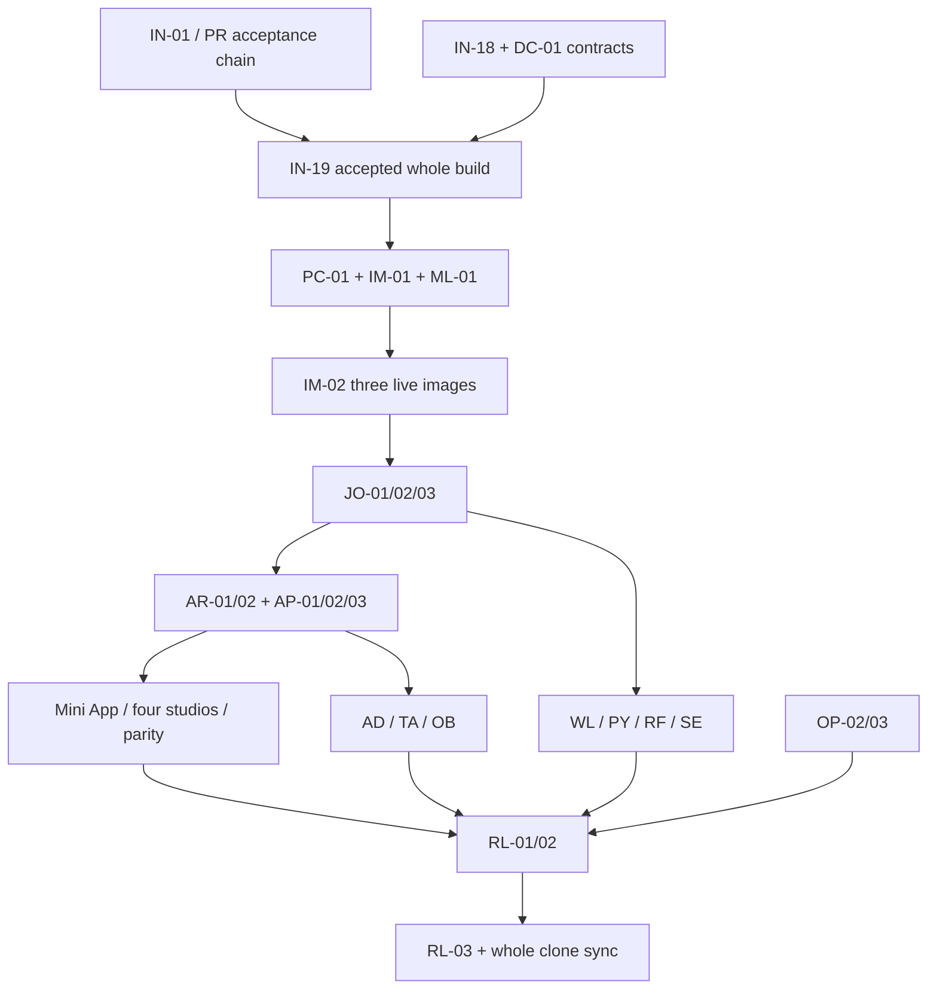

# IMPLEMENTATION DEPENDENCIES

Зависимости означают принятую совместимую базу либо отдельно согласованный stacked-docs/test branch; не просто наличие файла. [Task registry](MASTER_WORK_BREAKDOWN.md) и [решения](DECISIONS_REQUIRED.md). Нет обхода stage gate: широкая архитектура только после IM-02 или документированного внешнего blocker. Числовой S — gate результата, не обязательная дата начала подготовительного документа/fixture.

## Критический путь

IN-01 → IN-02 → IN-08 → IN-09 → IN-10 → IN-11 → IN-12 → IN-13 → IN-14 → IN-15 → IN-16 → IN-17; параллельно IN-18 → DC-01. Обе линии → IN-19 → PC-01 → IM-01; параллельно ML-01 → IM-02. Это первый реальный image результат. Для первой коммерческой генерации дополнительно PY-01 → PY-03, JO-01/02/03, WL-01/02, SE-01/02/03, OP-02/03, TQ-02 и owner RL-01 → RL-02. Готовый historical live image не заменяет текущую коммерческую checkout-приёмку.

## Полный DAG

| Задача | Предшественники | Решения owner | Контракты |
| --- | --- | --- | --- |
| [IN-01](MASTER_WORK_BREAKDOWN.md#in-01) | нет | D-01 | C-027 |
| [IN-02](MASTER_WORK_BREAKDOWN.md#in-02) | IN-01 | нет дополнительного | C-027 |
| [IN-08](MASTER_WORK_BREAKDOWN.md#in-08) | IN-02 | нет дополнительного | C-027 |
| [IN-09](MASTER_WORK_BREAKDOWN.md#in-09) | IN-08 | нет дополнительного | C-027 |
| [IN-10](MASTER_WORK_BREAKDOWN.md#in-10) | IN-09 | нет дополнительного | C-027 |
| [IN-11](MASTER_WORK_BREAKDOWN.md#in-11) | IN-10 | нет дополнительного | C-027 |
| [IN-12](MASTER_WORK_BREAKDOWN.md#in-12) | IN-11 | нет дополнительного | C-027 |
| [IN-13](MASTER_WORK_BREAKDOWN.md#in-13) | IN-12 | нет дополнительного | C-027 |
| [IN-14](MASTER_WORK_BREAKDOWN.md#in-14) | IN-13 | нет дополнительного | C-027 |
| [IN-15](MASTER_WORK_BREAKDOWN.md#in-15) | IN-14 | нет дополнительного | C-027 |
| [IN-16](MASTER_WORK_BREAKDOWN.md#in-16) | IN-15 | нет дополнительного | C-027 |
| [IN-17](MASTER_WORK_BREAKDOWN.md#in-17) | IN-16 | нет дополнительного | C-027 |
| [IN-18](MASTER_WORK_BREAKDOWN.md#in-18) | IN-02 | D-01 D-02 | C-027 |
| [IN-19](MASTER_WORK_BREAKDOWN.md#in-19) | IN-17, IN-18 | нет дополнительного | C-027 |
| [AR-01](MASTER_WORK_BREAKDOWN.md#ar-01) | JO-03 | нет дополнительного | C-001, C-008, C-012, C-024, C-025 |
| [AR-02](MASTER_WORK_BREAKDOWN.md#ar-02) | AR-01 | нет дополнительного | C-001, C-008, C-012, C-024, C-025 |
| [TG-01](MASTER_WORK_BREAKDOWN.md#tg-01) | IN-19 | нет дополнительного | C-001, C-002, C-004, C-017 |
| [TG-02](MASTER_WORK_BREAKDOWN.md#tg-02) | SL-01, TG-01 | нет дополнительного | C-001, C-002, C-004, C-017 |
| [TG-03](MASTER_WORK_BREAKDOWN.md#tg-03) | PY-01, TG-01 | нет дополнительного | C-001, C-002, C-004, C-017 |
| [MA-01](MASTER_WORK_BREAKDOWN.md#ma-01) | IN-19, OP-01 | D-05 | C-003, C-005, C-024 |
| [MA-02](MASTER_WORK_BREAKDOWN.md#ma-02) | AP-02, MA-01 | нет дополнительного | C-003, C-005, C-024 |
| [MA-03](MASTER_WORK_BREAKDOWN.md#ma-03) | MA-02, AP-03, JO-02 | нет дополнительного | C-003, C-005, C-024 |
| [MA-04](MASTER_WORK_BREAKDOWN.md#ma-04) | MA-03, VI-02, VO-02, MU-02, ML-03, RF-03, SL-03, PY-03 | нет дополнительного | C-003, C-005, C-024 |
| [AD-01](MASTER_WORK_BREAKDOWN.md#ad-01) | AP-01, TA-01 | D-04 | C-003, C-020, C-021, C-026 |
| [AD-02](MASTER_WORK_BREAKDOWN.md#ad-02) | AD-01, MC-01 | нет дополнительного | C-003, C-020, C-021, C-026 |
| [AD-03](MASTER_WORK_BREAKDOWN.md#ad-03) | AD-02, OB-02 | нет дополнительного | C-003, C-020, C-021, C-026 |
| [TA-01](MASTER_WORK_BREAKDOWN.md#ta-01) | IN-01 | нет дополнительного | C-019, C-021 |
| [TA-02](MASTER_WORK_BREAKDOWN.md#ta-02) | AD-02, TA-01 | нет дополнительного | C-019, C-021 |
| [PR-01](MASTER_WORK_BREAKDOWN.md#pr-01) | AR-01 | нет дополнительного | C-013, C-014, C-026, C-029 |
| [PR-02](MASTER_WORK_BREAKDOWN.md#pr-02) | PR-01 | нет дополнительного | C-013, C-014, C-026, C-029 |
| [PR-03](MASTER_WORK_BREAKDOWN.md#pr-03) | PR-02, IM-02 | D-06 | C-013, C-014, C-026, C-029 |
| [MC-01](MASTER_WORK_BREAKDOWN.md#mc-01) | PR-01 | нет дополнительного | C-006, C-014, C-015, C-029 |
| [MC-02](MASTER_WORK_BREAKDOWN.md#mc-02) | MC-01, MA-01 | нет дополнительного | C-006, C-014, C-015, C-029 |
| [PC-01](MASTER_WORK_BREAKDOWN.md#pc-01) | IN-19 | D-02 | C-007, C-008, C-015 |
| [PC-02](MASTER_WORK_BREAKDOWN.md#pc-02) | PC-01, AD-02 | D-02 | C-007, C-008, C-015 |
| [JO-01](MASTER_WORK_BREAKDOWN.md#jo-01) | IM-02 | нет дополнительного | C-012, C-018, C-025 |
| [JO-02](MASTER_WORK_BREAKDOWN.md#jo-02) | JO-01 | D-09 | C-012, C-018, C-025 |
| [JO-03](MASTER_WORK_BREAKDOWN.md#jo-03) | JO-02 | нет дополнительного | C-012, C-018, C-025 |
| [IM-01](MASTER_WORK_BREAKDOWN.md#im-01) | IN-19, PC-01 | нет дополнительного | C-007, C-012, C-013, C-016, C-018 |
| [IM-02](MASTER_WORK_BREAKDOWN.md#im-02) | IM-01, ML-01 | D-06 | C-007, C-012, C-013, C-016, C-018 |
| [VI-01](MASTER_WORK_BREAKDOWN.md#vi-01) | JO-03, PC-01 | нет дополнительного | C-006, C-012, C-013, C-016 |
| [VI-02](MASTER_WORK_BREAKDOWN.md#vi-02) | VI-01, AP-03, MC-02 | D-06 | C-006, C-012, C-013, C-016 |
| [VO-01](MASTER_WORK_BREAKDOWN.md#vo-01) | JO-03, PC-01 | нет дополнительного | C-006, C-012, C-013, C-016 |
| [VO-02](MASTER_WORK_BREAKDOWN.md#vo-02) | VO-01, AP-03, MC-02 | D-06 | C-006, C-012, C-013, C-016 |
| [MU-01](MASTER_WORK_BREAKDOWN.md#mu-01) | JO-03, PR-01 | D-02 D-08 | C-006, C-012, C-013, C-016 |
| [MU-02](MASTER_WORK_BREAKDOWN.md#mu-02) | MU-01, AP-03, MC-02 | D-06 D-08 | C-006, C-012, C-013, C-016 |
| [ML-01](MASTER_WORK_BREAKDOWN.md#ml-01) | IN-19 | нет дополнительного | C-016, C-017, C-018, C-030 |
| [ML-02](MASTER_WORK_BREAKDOWN.md#ml-02) | JO-03, ML-01 | нет дополнительного | C-016, C-017, C-018, C-030 |
| [ML-03](MASTER_WORK_BREAKDOWN.md#ml-03) | ML-02, MA-01 | нет дополнительного | C-016, C-017, C-018, C-030 |
| [WL-01](MASTER_WORK_BREAKDOWN.md#wl-01) | JO-03, PC-01 | нет дополнительного | C-008, C-011, C-025 |
| [WL-02](MASTER_WORK_BREAKDOWN.md#wl-02) | WL-01, PY-02 | D-02 D-03 | C-008, C-011, C-025 |
| [PY-01](MASTER_WORK_BREAKDOWN.md#py-01) | IN-19, PC-01 | D-02 | C-008, C-009, C-031 |
| [PY-02](MASTER_WORK_BREAKDOWN.md#py-02) | IN-19 | D-03 | C-008, C-009, C-031 |
| [PY-03](MASTER_WORK_BREAKDOWN.md#py-03) | AP-01, PY-01, MA-01 | D-06 | C-008, C-009, C-031 |
| [RF-01](MASTER_WORK_BREAKDOWN.md#rf-01) | AR-01, SL-01 | нет дополнительного | C-010, C-011, C-008 |
| [RF-02](MASTER_WORK_BREAKDOWN.md#rf-02) | RF-01, WL-01 | D-07 | C-010, C-011, C-008 |
| [RF-03](MASTER_WORK_BREAKDOWN.md#rf-03) | RF-02, AP-01 | нет дополнительного | C-010, C-011, C-008 |
| [SL-01](MASTER_WORK_BREAKDOWN.md#sl-01) | AR-01 | D-08 | C-001, C-002, C-022, C-030 |
| [SL-02](MASTER_WORK_BREAKDOWN.md#sl-02) | AD-01 | нет дополнительного | C-001, C-002, C-022, C-030 |
| [SL-03](MASTER_WORK_BREAKDOWN.md#sl-03) | SL-01, SL-02, MA-01 | нет дополнительного | C-001, C-002, C-022, C-030 |
| [SE-01](MASTER_WORK_BREAKDOWN.md#se-01) | AR-01, AD-01 | нет дополнительного | C-003, C-020, C-026, C-030 |
| [SE-02](MASTER_WORK_BREAKDOWN.md#se-02) | SE-01, ML-02 | D-08 | C-003, C-020, C-026, C-030 |
| [SE-03](MASTER_WORK_BREAKDOWN.md#se-03) | SE-02, AD-03, MA-03 | нет дополнительного | C-003, C-020, C-026, C-030 |
| [TQ-01](MASTER_WORK_BREAKDOWN.md#tq-01) | IN-19 | нет дополнительного | C-012, C-013, C-024, C-027 |
| [TQ-02](MASTER_WORK_BREAKDOWN.md#tq-02) | MA-04, TA-02, WL-02, SE-03 | нет дополнительного | C-012, C-013, C-024, C-027 |
| [OP-01](MASTER_WORK_BREAKDOWN.md#op-01) | IN-19 | D-05 | C-027, C-026 |
| [OP-02](MASTER_WORK_BREAKDOWN.md#op-02) | ML-02, WL-01 | D-09 | C-027, C-026 |
| [OP-03](MASTER_WORK_BREAKDOWN.md#op-03) | OP-02, JO-02, SE-02 | D-09 | C-027, C-026 |
| [OB-01](MASTER_WORK_BREAKDOWN.md#ob-01) | JO-03 | нет дополнительного | C-023, C-028 |
| [OB-02](MASTER_WORK_BREAKDOWN.md#ob-02) | OB-01, AD-01 | нет дополнительного | C-023, C-028 |
| [OB-03](MASTER_WORK_BREAKDOWN.md#ob-03) | OB-02, AD-03 | нет дополнительного | C-023, C-028 |
| [DC-01](MASTER_WORK_BREAKDOWN.md#dc-01) | IN-18 | нет дополнительного | C-001, C-008, C-012, C-013, C-024, C-027 |
| [DC-02](MASTER_WORK_BREAKDOWN.md#dc-02) | OP-03, TQ-02 | нет дополнительного | C-001, C-008, C-012, C-013, C-024, C-027 |
| [RL-01](MASTER_WORK_BREAKDOWN.md#rl-01) | PR-03, WL-02, PY-03, SE-03 | D-02 D-03 D-06 D-08 D-09 D-10 | C-027, C-028, C-030, C-031 |
| [RL-02](MASTER_WORK_BREAKDOWN.md#rl-02) | RL-01, TQ-02, OP-03, OB-03 | D-06 D-10 | C-027, C-028, C-030, C-031 |
| [RL-03](MASTER_WORK_BREAKDOWN.md#rl-03) | RL-02, DC-02 | D-10 | C-027, C-028, C-030, C-031 |
| [AP-01](MASTER_WORK_BREAKDOWN.md#ap-01) | AR-01 | нет дополнительного | C-003, C-007, C-012, C-024, C-025 |
| [AP-02](MASTER_WORK_BREAKDOWN.md#ap-02) | AP-01, AR-02, PC-01 | нет дополнительного | C-003, C-007, C-012, C-024, C-025 |
| [AP-03](MASTER_WORK_BREAKDOWN.md#ap-03) | AP-02, JO-02 | нет дополнительного | C-003, C-007, C-012, C-024, C-025 |
| [AU-01](MASTER_WORK_BREAKDOWN.md#au-01) | IN-18 | нет дополнительного | C-027, C-028 |
| [AU-02](MASTER_WORK_BREAKDOWN.md#au-02) | AU-01 | нет дополнительного | C-027, C-028 |

[Владельцы и reviewer всех 31 общих интерфейсов](CONTRACT_OWNERSHIP.md).

FIX-01: `parallel_with` симметрично и запрещено при прямой или транзитивной зависимости и пересечении консервативных областей `paths`. Read-only подготовка не является объявлением параллельного merge. См. [матрицу](PARALLEL_WORK_MATRIX.md).

## IN-01-FIX-04: координация

Порядок и зависимости RF-01/02/03, PY-02 и SL-02/03 определены реестром. Разрешённое повторное использование проверяется до реализации; владельцы совместно используемых файлов и миграций работают последовательно по существующей матрице блокировок.
